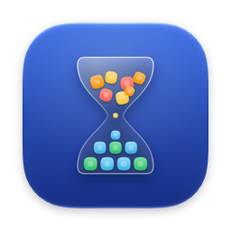
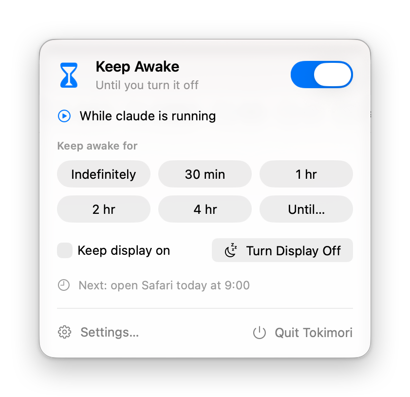
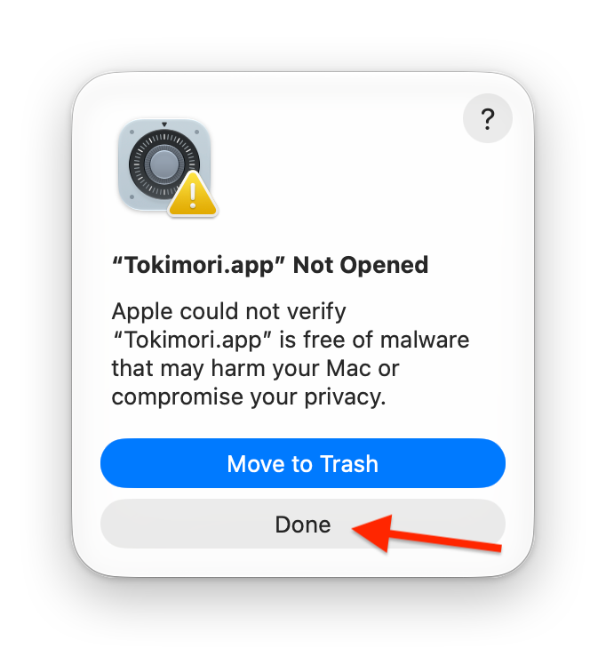
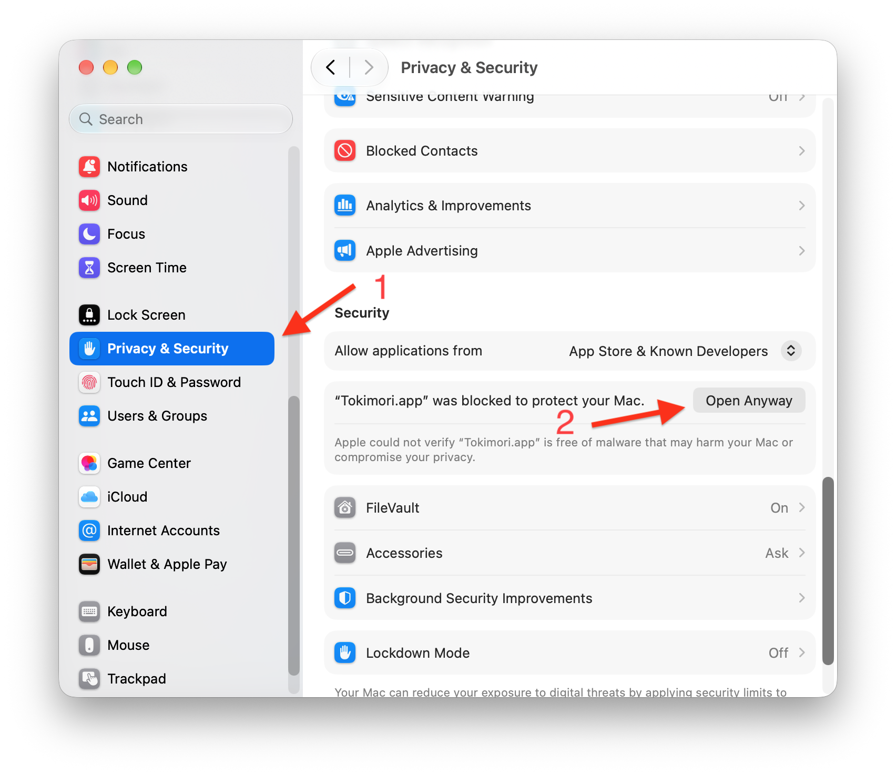
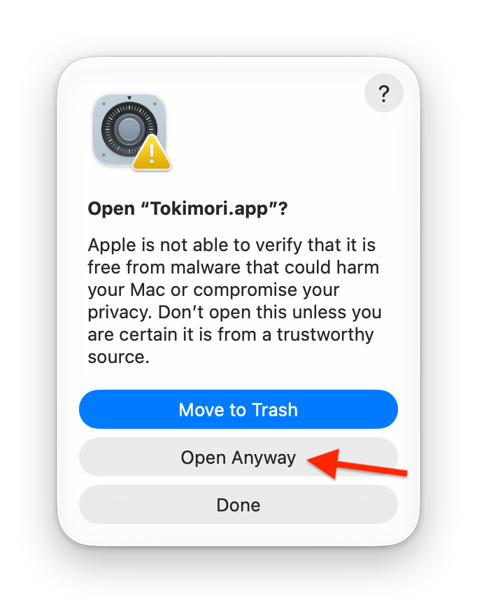
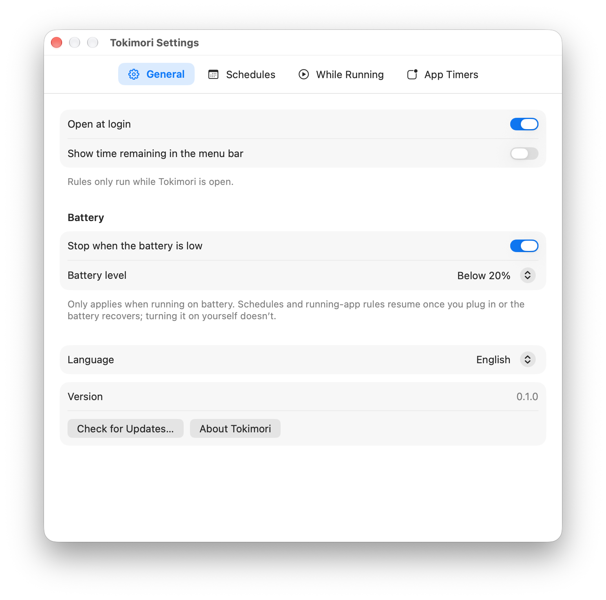
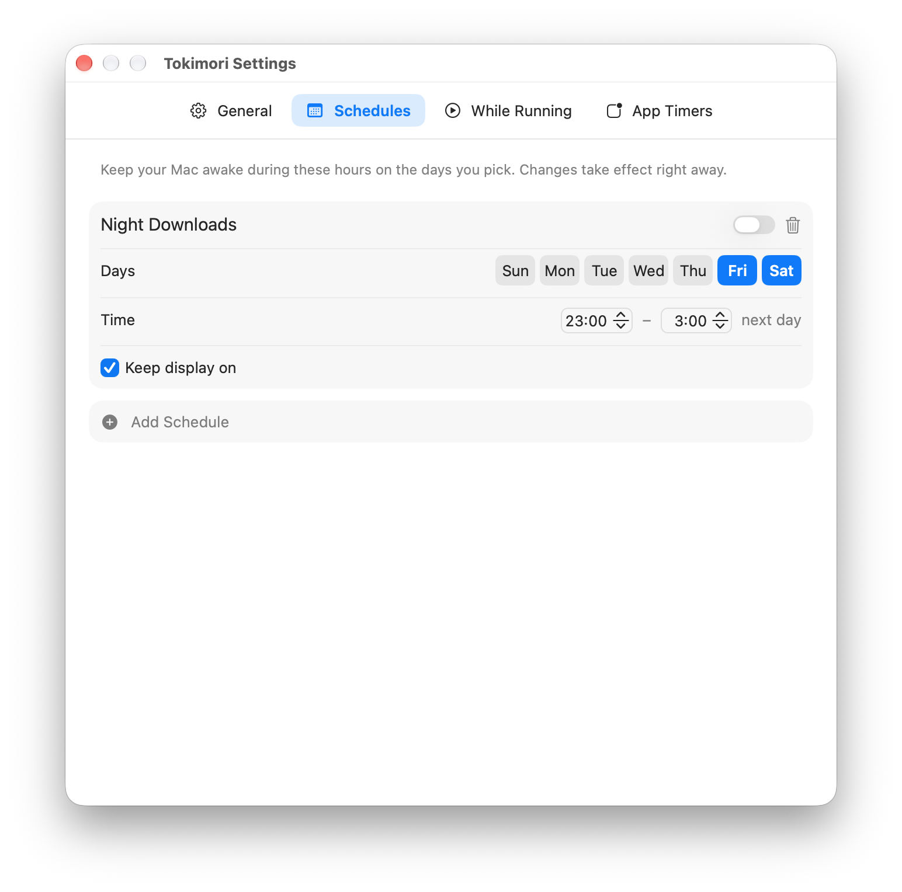
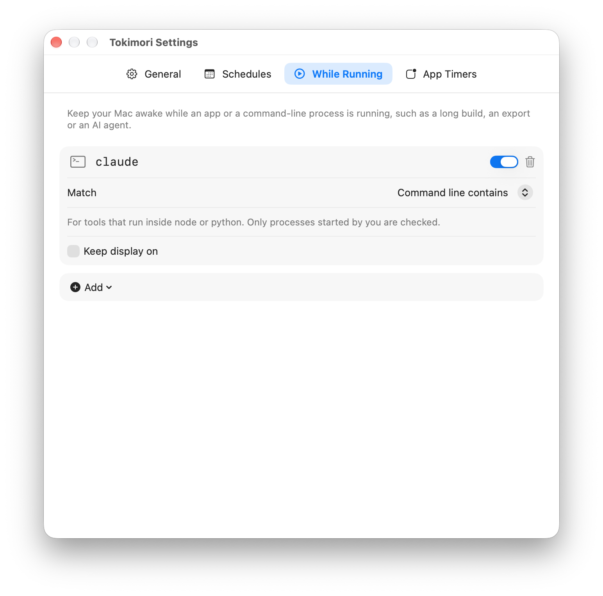
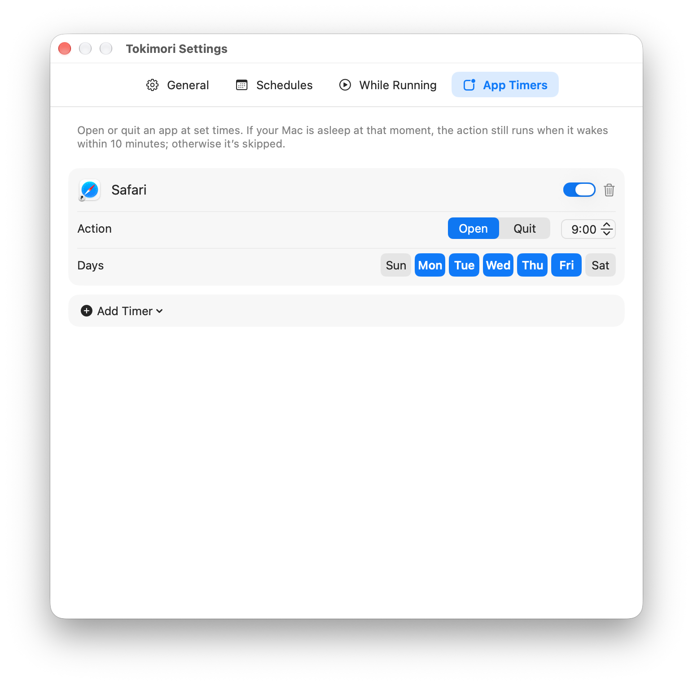

<p align="center">
  
</p>

<h1 align="center">Tokimori</h1>

<p align="center">
  <strong>Mantenha o Mac ativo quando precisar e abra ou encerre apps em horários programados.</strong>
</p>

<p align="center">
  
  
  
</p>

<p align="center">
  <a href="../../README.md">English</a> ·
  <a href="README.zh-Hans.md">简体中文</a> ·
  <a href="README.zh-Hant.md">繁體中文</a> ·
  <a href="README.ja.md">日本語</a> ·
  <a href="README.ko.md">한국어</a> ·
  <a href="README.de.md">Deutsch</a> ·
  <a href="README.fr.md">Français</a> ·
  <a href="README.es.md">Español</a> ·
  <b>Português</b> ·
  <a href="README.id.md">Bahasa Indonesia</a> ·
  <a href="README.th.md">ไทย</a> ·
  <a href="README.vi.md">Tiếng Việt</a> ·
  <a href="README.ar.md">العربية</a> ·
  <a href="README.ru.md">Русский</a> ·
  <a href="README.hi.md">हिन्दी</a>
</p>

Tokimori (時守り, “guardião do tempo”) é um app gratuito e de código aberto para a barra de menus do macOS. Ele impede que o Mac entre em repouso — agora mesmo, em um agendamento semanal ou enquanto um app ou comando específico estiver em execução — e abre ou encerra apps nos horários que você definir. Ele não tem ícone no Dock.

Use-o para impedir que o Mac entre em repouso durante downloads, compilações, exportações de vídeo, agentes de IA, sessões remotas ou apresentações. Ele usa o mesmo mecanismo do comando `caffeinate` integrado ao macOS, acrescenta menu, agendamentos e timers de apps, e nunca move o mouse.

<p align="center">
  
</p>

## Conteúdo

- [Recursos](#recursos)
- [Instalação](#instalação)
- [Uso](#uso)
- [Como funciona](#como-funciona)
- [Perguntas frequentes](#perguntas-frequentes)
- [Limitações conhecidas](#limitações-conhecidas)
- [Compilar a partir do código-fonte](#compilar-a-partir-do-código-fonte)

## Recursos

- **Manter ativo com um clique.** Ative por tempo indeterminado, por 30 minutos, 1, 2 ou 4 horas, ou até um horário escolhido. O sistema continua ativo enquanto a tela ainda pode se desligar no tempo de costume.
- **Manter a tela ligada ou desligá-la agora.** Se quiser, mantenha também a tela ligada. **Desligar Tela** escurece a tela enquanto o Mac continua funcionando.
- **Agendamentos.** Mantenha o Mac ativo em todos os dias úteis das 09:00 às 18:00, por exemplo. Um período pode terminar depois da meia-noite; nesse caso, ele pertence ao dia em que começa.
- **Durante execução.** Mantenha o Mac ativo enquanto um app estiver aberto ou enquanto um processo de linha de comando estiver em execução — identificado pelo nome (`ffmpeg`) ou por um texto da linha de comando (`claude`, para ferramentas que rodam dentro do `node` ou do `python`).
- **Timers de apps.** Abra ou encerre um app em dias escolhidos, em um horário definido. O mesmo app pode ter vários timers. Se um app não tiver encerrado após 30 segundos (por exemplo, porque está perguntando se você quer salvar), o Tokimori notifica você ou força o encerramento — você escolhe em cada timer.
- **Proteção da bateria.** Quando o Mac está usando a bateria abaixo de um nível que você escolhe (20% por padrão), o Tokimori deixa de mantê-lo ativo. Agendamentos e regras de execução voltam a funcionar assim que você conecta o carregador.
- **Ações do Atalhos.** *Manter Mac Ativo*, *Parar de Manter Mac Ativo* e *Mac Está Sendo Mantido Ativo* podem ser usadas no app Atalhos, por exemplo em uma automação de Foco ou de Wi-Fi.
- **15 idiomas.** Inglês, chinês simplificado, chinês tradicional, japonês, coreano, alemão, francês, espanhol, português, indonésio, tailandês, vietnamita, árabe, russo e hindi, alternáveis dentro do app.

## Instalação

Requer macOS 14 Sonoma ou posterior.

1. Abra a [página de Releases](https://github.com/zhaojiannet/tokimori/releases) e, em **Assets** da versão mais recente, baixe `Tokimori-<version>.dmg`.
2. Clique duas vezes no DMG baixado para abri-lo.
3. Arraste o **Tokimori** para a pasta **Aplicativos** exibida na mesma janela.
4. Ejete o DMG e abra o Tokimori a partir da pasta Aplicativos. Na primeira vez, o macOS pede que você o permita; consulte [Primeira abertura](#primeira-abertura).

Não há instalador e não é necessária senha de administrador.

**Atualizar:** baixe o novo DMG e arraste o Tokimori para Aplicativos novamente, substituindo a cópia antiga. Suas regras são mantidas. Para ver se há uma versão mais recente, clique em **Buscar Atualizações…** em Ajustes › Geral.

**Desinstalar:** encerre o Tokimori pelo menu dele e mova-o para o Lixo. Para remover também as regras e os ajustes, apague `~/Library/Application Support/net.zhaojian.tokimori` e `~/Library/Preferences/net.zhaojian.tokimori.plist`. Se você ativou **Abrir ao iniciar sessão**, desative antes ou remova o Tokimori em Ajustes do Sistema › Geral › Itens de Início.

### Primeira abertura

O Tokimori ainda não é notarizado pela Apple, por isso o macOS o bloqueia na primeira vez que você o abre. Permita uma vez:

1. Clique duas vezes no Tokimori. Quando o macOS disser que não conseguiu verificar o Tokimori, clique em **OK**. Não clique no botão azul **Mover para o Lixo**.

   

2. Abra **Ajustes do Sistema › Privacidade e Segurança**, role até **Segurança** e clique em **Abrir Mesmo Assim** ao lado do Tokimori. O botão fica disponível por cerca de uma hora após o passo 1.

   

3. Digite sua senha de início de sessão ou use o Touch ID. Na caixa de diálogo seguinte, clique em **Abrir Mesmo Assim** novamente.

   

Depois disso, o Tokimori abre normalmente. O DMG também traz estes passos em `First Launch.txt`.

## Uso

Clique na ampulheta na barra de menus. Enquanto algo estiver mantendo o Mac ativo, a areia escorre e a ampulheta vira a cada 30 minutos; quando o Mac pode entrar em repouso normalmente, ela fica parada com toda a areia em cima.

- **Manter Ativo** liga ou desliga o modo ativo. Abaixo, o Tokimori mostra o que está mantendo o Mac ativo agora e até quando.
- Os botões de duração mantêm o Mac ativo por esse tempo. **Até…** permite escolher um horário; um horário que já passou hoje significa amanhã.
- **Manter tela ligada** vale para o modo ativo que você liga manualmente. Agendamentos e regras de execução têm cada um seu próprio ajuste. A tela permanece ligada se qualquer fonte ativa pedir.
- A última linha mostra o próximo timer de app.

Se você desligar o modo ativo enquanto um agendamento estiver ativo, o Tokimori pergunta o que você quer:

- **Parar Até 18:00** — fica desligado pelo resto deste período; o agendamento liga de novo na próxima vez.
- **Desativar Este Agendamento** — o agendamento fica desativado até você reativá-lo nos ajustes.
- **Manter Acordado** — não muda nada.

Desligar também pausa as regras de execução ativas, até que o app ou processo correspondente seja encerrado.

Abra **Ajustes…** para gerenciar as regras. Cada regra é um cartão editado ali mesmo: as alterações valem na hora, a chave do cartão ativa ou desativa a regra e o botão de lixo a apaga.

- **Geral:** abrir ao iniciar sessão, mostrar o tempo restante ao lado do ícone da barra de menus, proteção da bateria, idioma, atualizações.
- **Agendamentos:** **Adicionar Agendamento** adiciona os dias úteis das 09:00 às 18:00; altere o nome, os dias e os horários no cartão.
- **Durante Execução:** **Adicionar** lista os apps abertos no momento; escolha um, escolha **Outro App…** ou escolha **Processo de Linha de Comando…** e digite o nome ou parte da linha de comando.
- **Timers de Apps:** **Adicionar Timer** lista os apps abertos no momento. Um novo timer abre o app às 09:00 nos dias úteis, ou o encerra às 18:00 se o app já tiver um timer de abertura. Para encerrar, escolha o que acontece se o app não tiver encerrado após 30 segundos. Um timer que abriria e encerraria o mesmo app no mesmo minuto que outro não pode ser ativado.

<p align="center">
  
  
  
  
</p>

Ao adicionar sua primeira regra, o Tokimori pergunta se deve abrir ao iniciar sessão, porque as regras só funcionam enquanto ele está aberto. Encerrar o Tokimori com regras ativas pede confirmação uma vez (você pode desativar essa pergunta).

## Como funciona

- O modo ativo usa uma asserção de energia do IOKit do tipo `PreventUserIdleSystemSleep`, o mesmo mecanismo do `caffeinate -i`. **Manter tela ligada** adiciona `PreventUserIdleDisplaySleep`. Execute `pmset -g assertions` no Terminal para vê-las. O Tokimori não move o mouse nem executa `caffeinate`.
- As asserções pertencem ao processo do Tokimori, então o macOS as libera automaticamente se o Tokimori for encerrado ou travar. O Mac nunca fica ativo por causa de uma asserção esquecida.
- O Tokimori recalcula quando um período começa ou termina, quando o Mac sai do repouso, quando o horário ou o fuso horário muda, quando apps são abertos ou encerrados, e a cada 30 segundos para processos e nível da bateria.
- Um timer de app que cai em um momento em que o Mac está em repouso ou o Tokimori não está em execução ainda é executado se o Tokimori perceber em até 10 minutos; os mais antigos são ignorados, para que você não receba uma enxurrada de aberturas e encerramentos desatualizados ao abrir a tampa de manhã.
- Para abrir é usado o `NSWorkspace`; para encerrar, o app é solicitado a encerrar normalmente, e o encerramento forçado usa `NSRunningApplication.forceTerminate()`. O macOS não permite que apps em sandbox encerrem outros apps, por isso o Tokimori não usa sandbox e não está na Mac App Store.
- As regras são armazenadas em `~/Library/Application Support/net.zhaojian.tokimori/configuration.json`. A única solicitação de rede é a busca de atualizações, e somente quando você clica nela.

## Perguntas frequentes

**Ele mantém meu MacBook ativo com a tampa fechada?**
Não. Fechar a tampa coloca o MacBook em repouso independentemente das asserções de energia, a menos que um monitor externo, um teclado e a alimentação estejam conectados (modo tampa fechada).

**Ele pode tirar meu Mac do repouso para executar um timer de app?**
Não. Tirar um Mac do repouso em um horário definido exige privilégios de administrador (`pmset schedule`). Os timers são executados enquanto o Mac está ativo, com a tolerância de 10 minutos descrita acima.

**Por que a tela ainda se desliga?**
Por padrão, só o repouso do sistema é impedido, o que geralmente é o que você quer para downloads, compilações e sessões remotas. Ative **Manter tela ligada** para apresentações ou monitoramento.

**Funciona com automações do Atalhos no macOS 26?**
Sim. Use as ações do Tokimori em uma automação pessoal, como “Quando eu me conectar ao Wi-Fi … Manter Mac Ativo”.

## Limitações conhecidas

- **Desligar Tela** também pode bloquear o Mac se você configurou em Ajustes do Sistema › Tela Bloqueada que a senha seja exigida depois que a tela se desliga.
- A identificação pela linha de comando só enxerga processos iniciados pela sua conta de usuário.
- Os timers de apps têm precisão de minutos e dependem de o Tokimori estar em execução.
- As traduções da interface ainda não foram revisadas por falantes nativos.

## Compilar a partir do código-fonte

Requer Xcode 27.

```sh
swift test --package-path TokimoriKit
xcodebuild -project Tokimori.xcodeproj -scheme Tokimori build
```

Para gerar um DMG:

```sh
scripts/package.sh
```

O resultado vai para `.build/dist/`, junto com um cask do Homebrew gerado a partir de `packaging/tokimori.rb` com a versão e o checksum preenchidos. Sem variáveis de ambiente, o app é assinado ad hoc e não é notarizado; nesse caso, o DMG inclui `First Launch.txt`. Defina `DEVELOPER_ID` (o nome de um certificado Developer ID Application) para assinar com ele e defina também `NOTARY_PROFILE` (um perfil de credenciais salvo com `xcrun notarytool store-credentials`) para notarizar e grampear o ticket.

As versões publicadas são compiladas pelo workflow do GitHub Actions em `.github/workflows/release.yml`. Como ele assina, e como publicar uma versão, está descrito em [docs/release.md](../release.md).

## Estrutura do projeto

- `TokimoriKit/`: um pacote Swift local. `TokimoriCore` contém a lógica de agendamento e seus testes; `TokimoriPlatform` encapsula as APIs do sistema (asserções de energia e bateria do IOKit, lista de processos, `NSWorkspace`).
- `Apps/Tokimori/`: o app da barra de menus (SwiftUI).
- `scripts/`, `packaging/`: o script de empacotamento e o modelo do cask do Homebrew.

## Licença

[MIT](../../LICENSE) © 2026 zhaoJian
